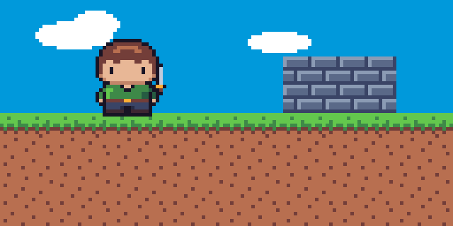

# Spritifer

Strumento **all-in-one per creare giochi 2D**: disegni gli **asset** in pixel art (personaggi animati, tileset, oggetti), costruisci le **scene** con mappe a tile e oggetti, dai vita al gioco con **eventi** visuali (quando → se → fai), **comportamenti** pronti (piattaforme, top-down, nemici, proiettili) e **script** JavaScript (dialoghi con scelte, NPC, battaglie a turni, interfacce), lo provi con **Play** e lo **esporti per il web** in un unico file HTML. Gestisce **più progetti**: platform, RPG o qualsiasi altro gioco, ognuno nella sua cartella.

Un **server MCP** permette a Claude Code di fare tutto questo con te: disegnare pixel per pixel, creare oggetti ed eventi, comporre i livelli, giocare il gioco in modalità headless per verificarlo ed esportarlo. Mentre Claude lavora, l'editor nel browser si aggiorna in tempo reale.



## Avvio rapido

```bash
npm install
npm run build
```

Avvia l'editor web (sprite salvati in `./sprites`):

```bash
npm start
```

Poi apri http://localhost:7420. Le schede in alto sono le parti del gioco: **Sprites** (asset), **Objects** (tipi di oggetto), **Scenes** (livelli), **Dialogues** (conversazioni), **Scripts** (codice), **Game** (impostazioni ed export), più **Play** ed **Export**. Il pulsante con il nome del progetto, in alto a sinistra, apre la pagina **Projects**.

### Progetti

Ogni gioco è una cartella con i suoi sprite, scene, script e `game.json`. Dalla pagina **Projects** puoi:

- creare un progetto nuovo, vuoto o da un modello: **Platformer** (*Coin Quest*: titolo, livello, monete, nemici, schermata di vittoria) o **RPG** (*Village*: villaggio top-down, NPC con dialoghi e scelte, missione, negozio, scrigno, battaglie a turni);
- aprire una cartella esistente qualsiasi;
- passare da un progetto all'altro. Ogni scheda del browser può mostrare un progetto diverso (`?project=<id>` nell'indirizzo).

I progetti nuovi vanno in `~/Documents/Spritifer` (si cambia con `--projects DIR` o `SPRITIFER_PROJECTS`). La cartella passata con `--workspace` è il progetto aperto all'avvio. Claude fa lo stesso via MCP con `list_projects`, `open_project` e `create_project`.

Per vedere gli esempi senza crearne una copia:

```bash
node dist/server/cli.js serve --workspace examples/village
```

## Creare giochi

### I concetti

| Concetto | Cos'è | Dove si modifica |
| --- | --- | --- |
| **Sprite** | Immagine con frame, livelli e tag di animazione (`idle`, `run`, `walk_down`…). Un *tileset* è uno sprite con griglia tile. | Sprites |
| **Oggetto** (object type) | Una "cosa" del gioco riusabile: giocatore, nemico, moneta, porta, proiettile, scritta. Ha uno sprite, una hitbox, **comportamenti**, **proprietà** (variabili d'istanza come `self.hp`) e un **foglio eventi**. Gli oggetti di testo (`text` + `hud`) mostrano punteggi ed etichette. | Objects |
| **Scena** | Un livello o una schermata: mappa a tile con più livelli (quelli *solid* sono pavimenti e muri), istanze degli oggetti posizionate, eventi e variabili di scena. | Scenes → editor di scena |
| **Gioco** | Titolo, risoluzione (es. 320×180), zoom, gravità, scena iniziale, variabili globali (`score`, `lives`…), controlli touch. | Game |

### Comportamenti

`platformer` (corsa, salto con coyote time e salto variabile, animazioni `idle/run/jump/fall` automatiche), `topdown` (8 direzioni, animazioni `walk_<dir>`/`idle_<dir>` come quelle generate dal rig dei personaggi), `solid` (anche *jump-through*), `bullet`, `patrol` (gira ai muri e ai bordi), `chase`, `sine` (fluttua), `camera` (la telecamera segue), `bounded`, `wrap`, `lifetime`.

### Eventi

Ogni evento è **QUANDO** *trigger* **SE** *condizioni* **FAI** *azioni*:

- **Trigger**: inizio scena, creato, ogni frame, tasto premuto/tenuto/rilasciato, collisione (inizio) o sovrapposizione con un tipo di oggetto, click/tap, timer, atterra, sbatte contro un muro, fine animazione, esce dalla scena, distrutto, messaggio ricevuto.
- **Condizioni**: espressione vera, tasto tenuto, a terra, sovrapposto a, probabilità, animazione corrente.
- **Azioni**: imposta/aggiungi variabile, muovi, posiziona, velocità, salto, crea istanza, distruggi, animazione, lampeggio, vai alla scena, riavvia scena, suono (effetti retrò sintetizzati: `coin`, `jump`, `hit`, `explosion`, `powerup`, `laser`…), scuoti la camera, messaggio a schermo, invia messaggio, salva variabile (record nel browser), log.

Le **espressioni** sono un piccolo linguaggio sicuro: `score + 10`, `self.hp <= 0 && !self.invincible`, `"Monete: " + score`, `count("enemy") == 0`, `dist(self.x, self.y, other.x, other.y) < 32`, `random(1, 6)`. Nomi: variabili globali (`score`), `self.*` e `other.*` (campi come `x`, `y`, `vx`, `vy`, `flipX`, `onGround` e le proprietà), `scene.*`, `game.time`.

### Dialoghi

Le conversazioni si scrivono come un copione, senza codice, nella scheda **Dialogues** (file `dialogues/<nome>.dialogue`, anche più dialoghi per file):

```
=== fornaio
self: Pane fresco! Solo 5 monete.
* Compra il pane [if gold >= 5]
  ~ gold -= 5
  ! sound coin
  self: Buon appetito!
* No grazie
  self: Torna quando vuoi.
```

- `Nome: testo` è una battuta con il nome di chi parla; `self:` usa il nome del personaggio piazzato nella scena; una riga senza nome è narrazione. `{espressione}` inserisce valori (`Hai {gold} monete`).
- `* scelta` crea un menu (la riga subito sopra diventa la domanda); `[if condizione]` mostra la scelta solo se vera; le righe rientrate sono quello che succede dopo.
- `if` / `elif` / `else` con blocchi rientrati, `~ variabile = valore` (anche `+=`, `-=`, e `self.x` per le proprietà del singolo personaggio), `! comando` (`sound`, `goto`, `call`, `emit`, `wait`, `shake`, `anim`, `face player`, `destroy`, `spawn`), `-> altro_dialogo` per saltare, `-> end` per finire.
- Gli errori compaiono mentre scrivi, con il numero di riga. Il pulsante ▶ accanto a ogni dialogo lo **prova** in una finestra a chat, con le variabili iniziali del gioco, e alla fine mostra cosa è cambiato.

**Un solo NPC, tanti personaggi.** Crea un tipo di oggetto con il comportamento **Talks (dialogue)** (modello *NPC (talks)*) e piazzalo quante volte vuoi. Nell'inspector della scena ogni istanza ha il suo **Name**, il suo **Sprite** e il suo **Dialogue**: il giocatore ci parla premendo Spazio/Z accanto. I dialoghi partono anche dagli eventi (azione **Start dialogue**, per esempio all'inizio della scena) e dagli script (`await dialogue('nome', self)`).

### Script

Per la logica che gli eventi non esprimono bene (sequenze animate, battaglie a turni, inventari, menu e HUD personalizzati) ci sono gli **script**: file JavaScript in `scripts/<nome>.js`, scritti nella scheda **Scripts** (evidenziazione, numeri di riga, salvataggio automatico, riferimento API a lato) o da Claude con `write_script` / `edit_script`.

```js
// Un comportamento: dai al tipo di oggetto { type: "script", name: "guard" }
behavior('guard', {
  update: (self, dt) => { if (self.distanceTo(player()) < 40) self.face(player().x < self.x ? 'left' : 'right') },
})

// Una funzione richiamabile dagli eventi con l'azione "Run script function"
func('apriPorta', async (self) => { self.play('open'); await wait(0.3); goto('dungeon') })

// Interfaccia disegnata ogni frame
onDraw((ui) => ui.bar(4, 4, 60, 6, vars.hp, vars.maxHp, '#e43b44'))
```

- **Registrazione**: `behavior` (hook `create`, `update`, `collide`, `interact`, `destroy`), `func`, `onStart`, `onSceneStart`, `onUpdate`, `onDraw`, `onMessage`.
- **Flusso asincrono**: `await say()` (finestra di dialogo con effetto macchina da scrivere, il gioco si ferma), `await choose([...])` (menu), `await wait(s)`, `await waitUntil(fn)`, `await self.moveTo(x, y)`, `lockControls()`.
- **Stato e istanze**: `vars`, `scene`, `game`, `camera`, `find`, `findOne`, `player()`, `spawn`; le istanze espongono campi (`x`, `y`, `facing`…), proprietà (`self.hp`) e metodi (`play`, `destroy`, `flash`, `face`, `say`).
- **Interfaccia**: `ui.text`, `ui.panel`, `ui.bar`, `ui.rect`, `ui.sprite`.

Gli eventi possono usare le azioni **Dialog** (finestra RPG), **Run script function** e **Lock player controls**, e il trigger **Player interacts**: si attiva quando il giocatore preme azione accanto all'istanza o rivolto verso di essa.

Nel playtest di Claude gli script girano isolati (`node:vm`). I dialoghi si confermano da soli e `choices` sceglie le voci dei menu, così Claude può verificare missioni e battaglie senza browser.

### RPG

- Giocatore `topdown` con animazioni `walk_<dir>`/`idle_<dir>` e hitbox sui piedi.
- Scene con **Sort by Y**: chi sta più in basso viene disegnato davanti, per dare profondità.
- Livelli tile *solid* per muri, alberi e acqua.
- NPC con il comportamento *Talks (dialogue)*: un tipo di oggetto, tanti personaggi diversi (nome, sprite e dialogo per istanza). Scrigni come dialoghi che usano le proprietà dell'istanza (`~ self.opened = true`, `~ gold += self.gold`).
- Scene con memoria, così il villaggio resta com'era dopo una battaglia.
- Battaglie in una scena dedicata, guidate da `onSceneStart('battle', async () => …)`, con menu `choose` e barre HP in `onDraw`.

L'esempio `examples/village` mostra tutto questo: tutte le conversazioni stanno in `dialogues/village.dialogue`, la battaglia in `scripts/battle.js`, il messaggio di benvenuto è un evento della scena *town* (*Scene starts* → *Start dialogue intro*).

### Editor di scena

A destra ci sono tre schede: **Hierarchy** (tutti gli oggetti piazzati nella scena, con filtro; cliccandone uno lo selezioni e lo inquadri), **Add** (i tipi di oggetto da piazzare) e **Scene** (dimensioni, sfondo, Sort by Y, memoria, variabili, eventi). Sotto c'è l'**Inspector** dell'istanza selezionata: nome, tipo, sprite e animazione propri, dialogo, posizione, proprietà (anche solo di quell'istanza).

Con **Remember instances when leaving** la scena ricorda posizioni, proprietà e oggetti distrutti quando la lasci (per esempio un villaggio dopo una battaglia); *Restart scene* la riporta all'inizio.


- Strumenti: pennello tile (B, trascina sul tileset per un timbro multi-tile), rettangolo (R), secchiello (G), gomma (E, o tasto destro), piazza oggetti (P, allineati al tile; Alt = posizione libera), seleziona/sposta (V, aggancio alla griglia; Alt = libero).
- Alt+click preleva un tile, Canc elimina l'istanza selezionata, Ctrl+D la duplica, frecce per spostarla di 1 px (Shift = 1 tile), Ctrl+Z / Ctrl+Shift+Z.
- Livelli tile con visibilità, *solid*/*decor*, ordine di disegno (z > 0 = davanti agli oggetti) e parallasse.
- Inspector dell'istanza (posizione, specchiatura, proprietà sovrascritte), impostazioni della scena, foglio eventi della scena.

### Play ed export per il web

- **Play** apre il gioco in sovrimpressione (da tutta l'avventura o dalla scena corrente) con la console dei log ed errori, riavvio e visualizzazione delle hitbox (F2).
- **Export** scrive `<workspace>/export/web/<titolo>/index.html`: **un solo file** con motore, scene e immagini incorporate. Funziona offline, su qualsiasi hosting statico e si carica su itch.io come gioco HTML5. Lo stesso file si scarica dal pulsante *Download HTML*.
- Il runtime (~17 KB gzip) scala il gioco a pixel interi quando possibile, supporta tastiera (frecce/WASD, Spazio/Z/J, X/K, Invio), mouse, **controlli touch** su telefono e **gamepad**.

### Con Claude

Chiedi per esempio:

> Fai un platform: un eroe 16×16 con animazioni idle/run/jump, un tileset 16px con erba, terra e piattaforme, monete che danno punti, slime che pattugliano e una bandiera che porta alla schermata di vittoria. Poi provalo e esportalo.

Claude disegna gli asset, crea gli oggetti con `set_object`, compone i livelli con `create_scene`, `paint_tiles` e `place_instances`, scrive gli eventi, poi verifica con `validate_game`, `preview_scene` e `playtest` (che esegue il gioco senza browser con input scriptati e restituisce log, stato finale e screenshot) prima di `export_game`.

## Far disegnare Claude Code

### In questo progetto

Il file `.mcp.json` registra già il server `spritifer`. Apri Claude Code in questa cartella, approva il server e chiedi ad esempio:

> Disegna un cavaliere 32×32 con palette sweetie16, con animazioni idle (2 frame) e walk (4 frame), poi esporta lo spritesheet.

### Nel progetto del tuo gioco

Dalla cartella del gioco, registra il server (gli sprite finiranno in `./sprites` del gioco):

```bash
node /percorso/di/Spritifer/dist/server/cli.js init
```

In alternativa, con la CLI di Claude Code:

```bash
claude mcp add spritifer -- node /percorso/di/Spritifer/dist/server/cli.js mcp --workspace ./sprites
```

Quando Claude Code avvia il server MCP, parte anche l'editor su http://localhost:7420 (se la porta è libera). Se hai già `npm start` in esecuzione, i due processi condividono gli stessi file e l'editor resta sincronizzato.

## Strumenti MCP

| Categoria | Strumenti |
| --- | --- |
| Sprite | `list_sprites`, `create_sprite`, `get_sprite`, `duplicate_sprite`, `delete_sprite`, `set_palette`, `resize_canvas` |
| Livelli | `add_layer`, `update_layer`, `delete_layer`, `merge_layer_down` |
| Animazione | `add_frames` (con `copy_from`), `delete_frames`, `move_frame`, `set_frame_duration`, `set_tag`, `delete_tag` |
| Personaggi (rig) | `create_character`, `rig_part`, `rig_remove_part`, `rig_preview`, `rig_pose`, `rig_animate`, `rig_keyframes` (pose chiave + easing) |
| Forme e materiali | `draw_shapes` (capsule, ellissi, poligoni, spline, linee pixel-perfect, archi per le scie), `set_ramp` (rampe hue-shifted in OKLCH, colori `nome.N`), `shade`, `selout`, `cleanup` |
| Da concept a pixel art | `pixelize` (converte un'immagine ad alta risoluzione in pixel art pulita su un livello) |
| Riferimento e posa | `set_reference` (ritaglio, scala, rimozione dello sfondo, palette estratta, copia su un livello), `pose_guide` (scheletro di posa), `silhouette_check` (confronto delle sagome con il riferimento) |
| Disegno | `draw_pixels` (griglia di caratteri + legenda), `set_pixels`, `draw_line`, `draw_rect`, `draw_ellipse`, `fill`, `replace_color`, `clear`, `outline`, `mirror`, `transform` (shift/flip/rotate), `copy_region` |
| Verifica | `preview` (righelli con coordinate, `region` per lo zoom, `tags` = una riga per animazione, `onion`, `diff`, `compare`/`underlay` col riferimento), `lint` (problemi con coordinate), `read_pixels` (griglia testuale) |
| Export/import | `export_spritesheet` (PNG + JSON), `import_png` |
| Gioco | `game_reference` (vocabolario completo di trigger, condizioni, azioni, comportamenti ed espressioni), `get_game`, `set_game`, `set_object`, `delete_object`, `set_events` |
| Scene | `create_scene`, `get_scene` (anche la mappa come griglia di caratteri), `update_scene`, `delete_scene`, `set_tile_layer`, `paint_tiles` (righe + legenda come `draw_pixels`, o rettangoli), `place_instances`, `update_instances`, `tileset_preview` (indici dei tile) |
| Dialoghi | `dialogue_reference`, `list_dialogues`, `read_dialogue`, `write_dialogue` (controllato prima di salvare), `edit_dialogue`, `delete_dialogue`; `place_instances` / `update_instances` con nome, sprite e `props.dialogue` per istanza |
| Script | `script_reference` (API completa con esempio di battaglia), `list_scripts`, `read_script`, `write_script` (con controllo della sintassi e nomi registrati), `edit_script`, `delete_script` |
| Progetti | `list_projects`, `open_project`, `create_project` (vuoto, platformer, rpg) |
| Verifica ed export del gioco | `validate_game`, `preview_scene`, `playtest` (gioco headless con input scriptati e risposte ai menu: log, dialoghi, stato, screenshot), `export_game` (HTML unico per il web), `undo_game_change` |
| Altro | `undo`, `editor_url` |

`draw_pixels` è lo strumento principale: Claude scrive righe di caratteri e una legenda colore, ad esempio:

```json
{
  "sprite": "slime",
  "x": 4, "y": 6,
  "rows": [".kkkk.", "kggggk", "kgwgwk", "kggggk", ".kkkk."],
  "legend": { "k": "#181425", "g": "#63c74d", "w": "#ffffff" }
}
```

I colori si indicano come `#rrggbb`, `#rrggbbaa`, `transparent` o indice di palette (`p3`). I caratteri `.` e spazio non presenti nella legenda lasciano i pixel invariati.

### Personaggi animati (top-down, 4 direzioni)

I personaggi per i giochi si costruiscono con un **rig a parti** invece di ridisegnare ogni frame:

1. `create_character` (consigliato 48×48) crea lo sprite, il livello `rig` e un frame di riposo.
2. `rig_part` disegna ogni parte su una piccola griglia (`body`, `head`, `arm_l`, `arm_r`, `leg_l`, `leg_r`, più `weapon`, `scarf`/`cape`/`hair`, `shadow`) per le viste `down`, `right` e `up`. La vista `left` è specchiata da `right`. Ogni parte ha un `pivot` (l'articolazione), una posizione `at` e un ordine `z` per vista. Le varianti (`blink`, `hurt`) sostituiscono il disegno in certi frame.
3. `rig_animate` genera `idle`, `walk`, `run`, `attack` e `hurt` per tutte le direzioni: frame, tag `<animazione>_<direzione>`, tempi, saltello del corpo, braccia opposte alle gambe, sciarpa/mantello che seguono in ritardo, scia della spada.
4. `rig_pose` ritocca singoli frame; correggere una parte con `rig_part` aggiorna tutti i frame.
5. `export_spritesheet` con `layout: "tags"` produce una riga per animazione.

Le rotazioni usano RotSprite, quindi braccia e spade ruotate restano pixel art pulita. Il livello `rig` viene rigenerato dai dati del rig: gli effetti disegnati a mano vanno su un altro livello.

### Come lavora Claude

Le istruzioni che il server MCP manda a ogni sessione (`INSTRUCTIONS` in `src/server/mcp.ts`) descrivono il flusso che dà i risultati migliori:
1. partire da un'immagine;
2. convertirla con `pixelize`, oppure disegnare con riferimento, scheletro, forme, rampe, ombre con volume e contorno selettivo;
3. controllare dopo ogni passata con `silhouette_check` e `lint`.

Descrivono anche le trappole note. `draw_shapes` avvisa da solo quando una linea ha uno spessore non intero o quando una forma è troppo sottile per avere un contorno.

### Versioni

Ogni `silhouette_check` salva una versione dello sprite con il suo punteggio (sovrapposizione e avvisi sui valori) in `<workspace>/.versions/<nome>/`. Se una passata peggiora il risultato, il controllo lo dice ("WORSE than your best version") e `restore_version` riporta alla versione migliore. `versions` elenca le versioni, `save_version` ne salva una a mano. A differenza di `undo`, le versioni sopravvivono ai riavvii.

### Disegnare con precisione

- `draw_shapes` descrive le forme con coordinate (anche frazionarie) invece di scrivere ogni pixel: un braccio è una capsula da spalla a polso, una ciocca di capelli una spline chiusa, la scia di un fendente un arco con gradiente.
- `set_ramp` crea una rampa per materiale (pelle, stoffa, metallo…). `shade` applica ombra, ombra profonda e luce seguendo la direzione della luce, senza pillow shading. `selout` colora i contorni interni con il tono scuro del materiale.
- `preview` ha righelli con le coordinate, quindi le correzioni si fanno su pixel esatti. `lint` elenca pixel isolati, scalettature, contorni mancanti e colori troppo simili, con le coordinate.
- `set_reference` aggancia un'immagine di riferimento, che `preview` mostra a fianco (`compare`) o in trasparenza sotto (`underlay`). Con `remove_background` lo sfondo diventa trasparente.
- `pose_guide` piazza uno scheletro (testa, collo, bacino, spalle, gomiti, mani, anche, ginocchia, piedi; `_f` = lato verso la camera, `_b` = lato lontano) da ricalcare sul riferimento prima di disegnare. `preview` con `guide: true` lo disegna sopra il disegno e sopra il riferimento.
- `silhouette_check` confronta la sagoma del disegno con quella del riferimento: percentuale di sovrapposizione, pixel mancanti ed extra, e una tabella per fasce di righe che dice di quanti pixel spostare il bordo sinistro o destro.

### Da concept a pixel art

`pixelize` converte un'immagine (concept, illustrazione, render) in pixel art alla dimensione voluta:
- i colori vengono ridotti a una palette percettiva, o a quella dello sprite;
- ogni pixel prende il colore *prevalente* della zona che copre, invece della media, quindi niente sfocature né colori fangosi;
- i contorni scuri sopravvivono e il rumore di quantizzazione sparisce, mentre restano i riflessi voluti.

Altri dettagli:
- Lo sfondo viene rimosso da solo, anche se è una griglia o una scacchiera di grigi: il contorno del personaggio resta anche dove una linea della griglia lo attraversa.
- Lo spessore dei contorni (`line_bias`) si regola da solo per mantenere l'equilibrio di luci e ombre dell'immagine.
- I colori quasi identici vengono uniti e la palette dello sprite viene ridotta ai colori usati.

L'immagine diventa anche il riferimento dello sprite. Il flusso consigliato: `pixelize` per la base, ritocco di viso, mani e dettagli con gli strumenti di disegno, poi `silhouette_check` per verificare sagoma, valori e colori.

`silhouette_check` confronta anche i **valori** (quota di scuri, medi e chiari, contrasto, saturazione) e dà indicazioni concrete, per esempio "troppo chiaro, sposta i colori base di una tonalità più scura".

### Volume, ombre e anti-aliasing

- `shade` con `mode: "form"` tratta la forma come un volume illuminato in 3D: le capsule diventano cilindri e le ellissi sfere, con `rim` per la luce riflessa sul bordo in ombra.
- In `draw_shapes`, `cast_shadow` scurisce ciò che sta sotto la forma dal lato opposto alla luce (capelli sul viso, testa sul collo), e `aa` ammorbidisce il bordo con colori intermedi presi dalla palette.

### Ambienti e tileset

1. `create_sprite` con `tile_width`/`tile_height` (es. tileset 64×64 con tile 16×16).
2. Disegna ogni tile con `draw_pixels` usando il parametro `tile: {col, row}`.
3. Per i livelli giocabili usa una **scena** (`create_scene` + `paint_tiles`, vedi *Creare giochi*). Per un'illustrazione statica crea invece uno sprite più grande e componilo con `copy_region` (`source_sprite` = tileset, `source_tile`, più `targets`), con livelli separati per cielo, terreno e oggetti.

## Editor

- Strumenti: matita (B), gomma (E), riempimento (G), contagocce (I), linea (L), rettangolo (R), ellisse (O), sposta (M). Click sinistro/destro = colore primario/secondario, Alt+click = preleva colore.
- Simmetria orizzontale, griglia pixel e griglia tile, onion skin, zoom con rotellina, pan con Spazio+trascina.
- Livelli con visibilità, opacità, unione; palette con preset (PICO-8, Sweetie 16, DB16, Endesga 32, Game Boy).
- Timeline con miniature, durata per frame, tag di animazione (forward/reverse/pingpong), anteprima animata.
- Annulla/ripeti (anche le modifiche fatte da Claude), salvataggio automatico.
- Import di PNG e spritesheet esistenti (con taglio in frame).

## Export

`export_spritesheet` (o il pulsante **Export**) produce:

- `nome.png` con layout orizzontale, verticale, griglia, o una riga per tag; padding, margine e scala intera configurabili;
- `nome.json` in formato **Aseprite (array)**: rettangoli dei frame, durate e `frameTags`. È letto direttamente da Phaser (`load.aseprite`), Godot (importer Aseprite), Unity e LibGDX.

Esempio Phaser:

```js
this.load.aseprite('hero', 'sprites/export/hero.png', 'sprites/export/hero.json');
// ...
this.anims.createFromAseprite('hero');
this.add.sprite(100, 100, 'hero').play({ key: 'walk', repeat: -1 });
```

## Formato dei file

Il workspace (default `./sprites`) contiene tutto il progetto:

- `<nome>.sprite.json`: dimensioni, palette, livelli, frame, tag, griglia tile opzionale e pixel RGBA (base64) per ogni cel `livello/frame`;
- `<nome>.scene.json`: dimensioni in tile, tileset, livelli tile (indici, `-1` = vuoto), istanze, eventi e variabili della scena;
- `game.json`: impostazioni, variabili globali e tipi di oggetto con comportamenti ed eventi;
- `scripts/<nome>.js`: gli script del gioco;
- `dialogues/<nome>.dialogue`: i dialoghi.

Sono JSON leggibili e versionabili. L'editor e il server MCP leggono e scrivono gli stessi file; un watcher notifica le modifiche al browser via WebSocket.

## Sviluppo

```bash
npm test            # test di core, motore di gioco, server MCP e API HTTP
npm run typecheck
npm run dev:web     # Vite con hot reload (richiede `npm start` per l'API)
```

Struttura:

- `src/core` — modello dello sprite, algoritmi di disegno, layout degli spritesheet (condiviso tra browser e Node)
- `src/core/game` — modello del gioco, catalogo eventi/comportamenti, linguaggio delle espressioni, host degli script (API, dialoghi, menu, UI), **motore** deterministico e indipendente dal rendering (usato dal browser e dai playtest headless)
- `src/runtime` — player per il browser (canvas, input, touch, gamepad, audio sintetizzato), compilato in `dist/runtime/player.js` e incorporato nei giochi esportati
- `src/server` — workspace su disco, registro dei progetti, codec PNG, server HTTP + WebSocket, server MCP, esecuzione degli script con `node:vm`, export del gioco, CLI
- `src/web` — editor nel browser (TypeScript senza framework): progetti, sprite, oggetti, eventi, scene, script, impostazioni del gioco
